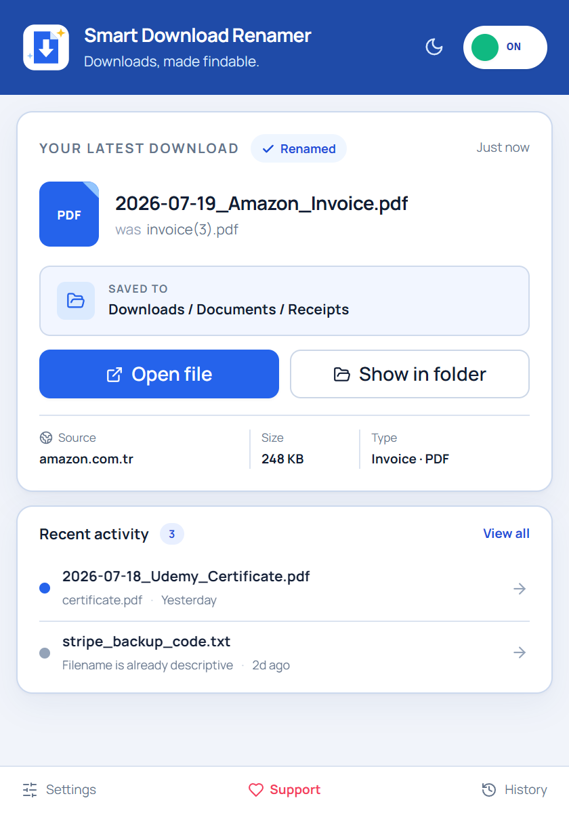
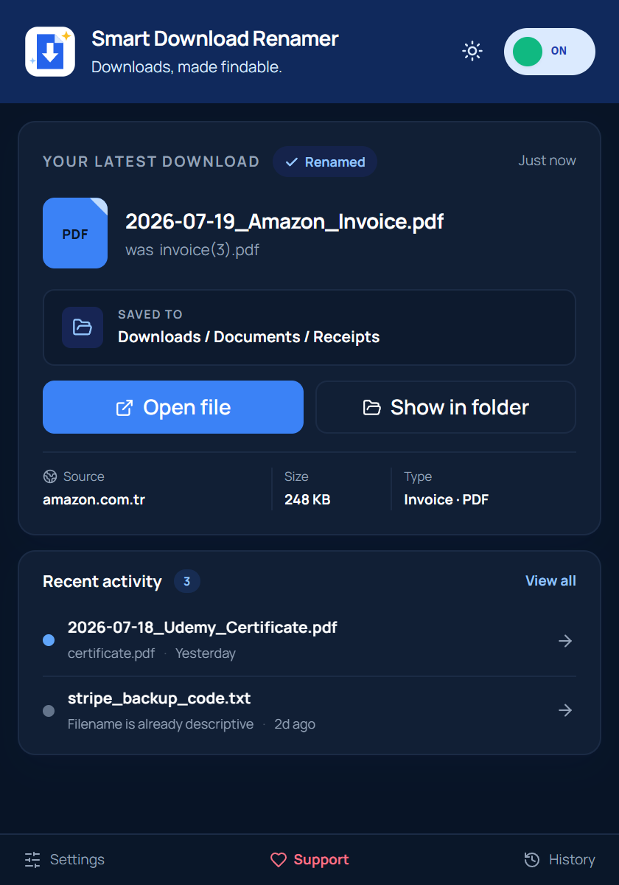
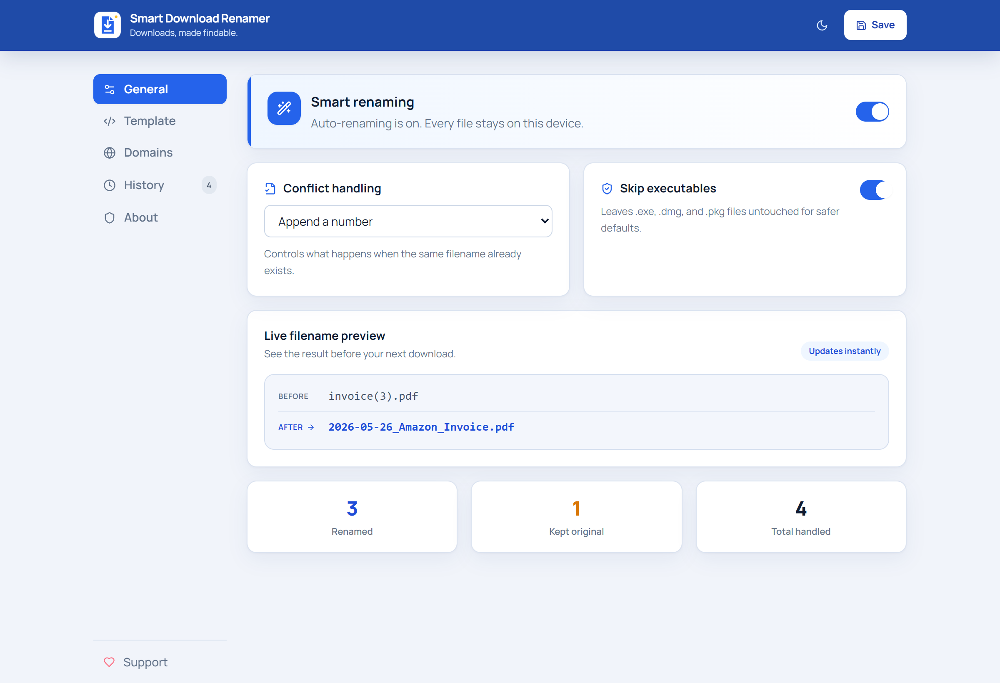
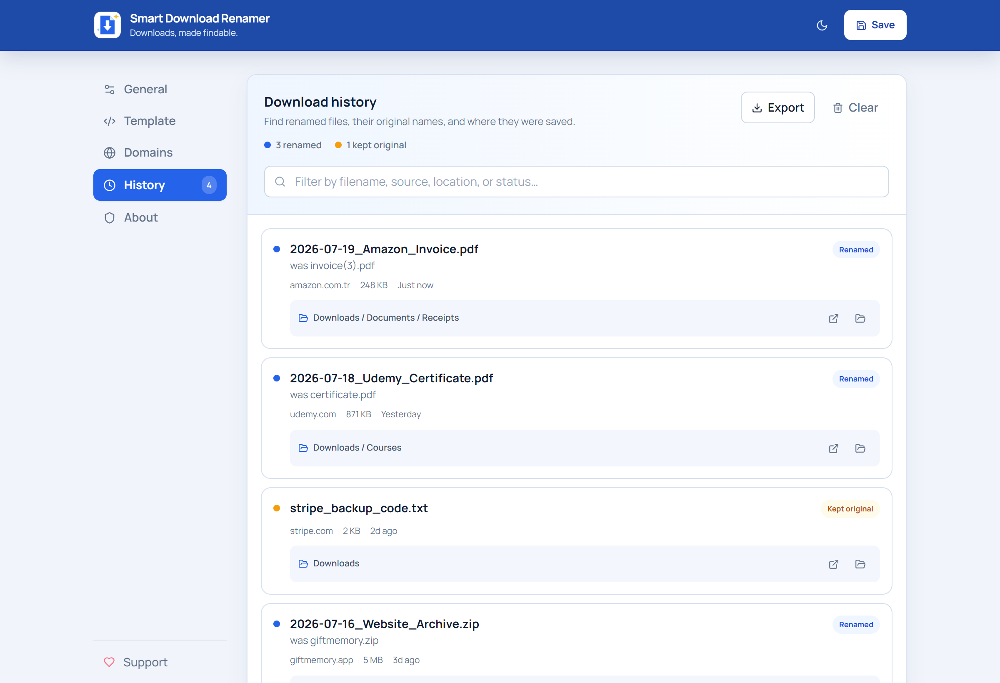
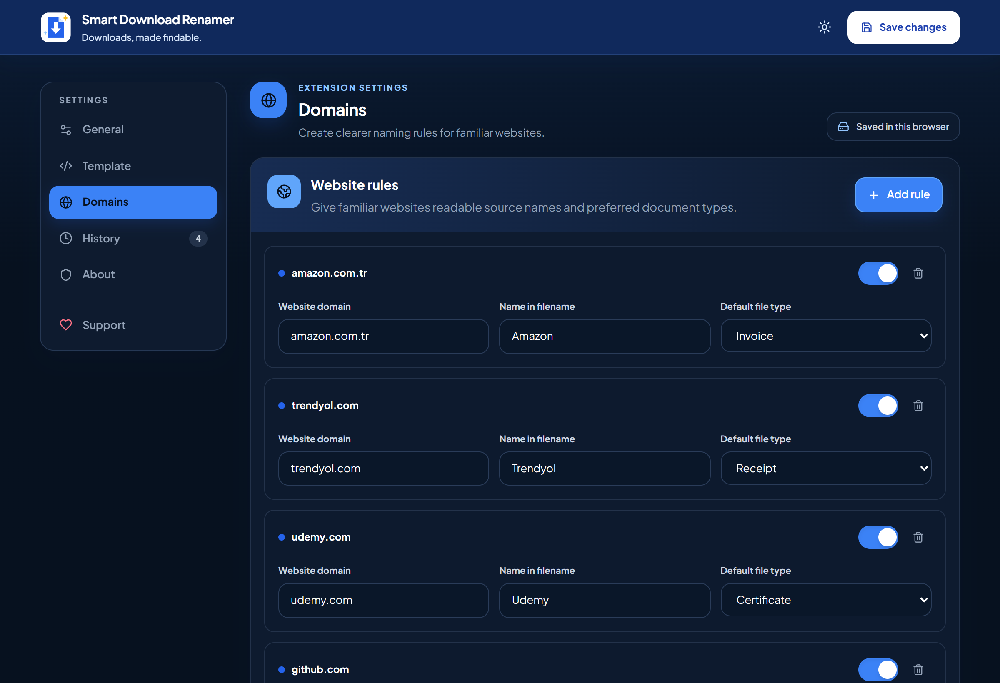

# Smart Download Renamer

**Automatically rename messy downloads into clean, searchable filenames — 100% local, no account, no backend.**

[](https://github.com/tahsinsoyak/smartdownload-renamer-extension/releases)
[](LICENSE)
[](https://developer.chrome.com/docs/extensions/mv3/)
[](https://www.patreon.com/tahsinsoyak)

---

## Screenshots

| Popup | Popup Dark |
|-------|------------|
|  |  |

| Options — General | Options — History |
|-------------------|-------------------|
|  |  |

| Options — Domains (dark) |
|--------------------------|
|  |

---

## What it does

Instead of `invoice(3).pdf`, `download.pdf`, or `document.pdf` you get:

```
2026-05-26_Amazon_Invoice.pdf
2026-05-26_Udemy_Certificate.pdf
2026-05-26_Bank_Receipt.pdf
2026-05-26_GitHub_Download.zip
```

The extension intercepts each download before it hits your folder, reads its URL and metadata locally, and suggests a clean filename automatically.

---

## Features

- **Automatic renaming** — triggers on every download with zero friction
- **Source detection** — reads the domain and maps it to a readable name (Amazon, Trendyol, GitHub, …)
- **Document classification** — detects invoices, receipts, certificates, transcripts, and 10+ other types from filename keywords
- **Custom templates** — `{date}_{source}_{type}.{ext}` and five built-in presets
- **Domain rules** — map any domain to a custom source name and default document type
- **Filename history** — see what was renamed, skipped, or failed with timestamps
- **Dark mode** — full light/dark support
- **English and Turkish** — localized popup, settings, dates, statuses, and document labels
- **Skip executables** — never touches `.exe`, `.dmg`, `.pkg` files
- **No account, no backend, no analytics** — everything runs in your browser

---

## Privacy

Smart Download Renamer works entirely locally. It uses Chrome-provided download metadata, including filenames and source URLs, only to suggest cleaner filenames and show completed download details. It does not read downloaded file contents. Nothing is sent to the developer or any server.

**Permissions used:**
- `downloads` — detects downloads, suggests filenames, and shows completed downloads in their folders
- `downloads.open` — opens a completed file only after you choose **Open file**
- `storage` — saves settings, rules, language, theme, and rename history locally

**Not collected or transmitted:** file contents · cookies · accounts · analytics · advertising identifiers · telemetry

Read the full [Privacy Policy](docs/privacy-policy.md) and [Support information](docs/support.md).

---

## Install

### From source

```bash
git clone https://github.com/tahsinsoyak/smartdownload-renamer-extension.git
cd smartdownload-renamer-extension
npm install
npm run build
```

Then in Chrome:
1. Go to `chrome://extensions`
2. Enable **Developer mode**
3. Click **Load unpacked**
4. Select the `dist/` folder

### From release

Download `smart-download-renamer.zip` from [Releases](https://github.com/tahsinsoyak/smartdownload-renamer-extension/releases), unzip it, and load the folder as an unpacked extension.

---

## Development

```bash
npm run dev       # Vite dev server for popup and options UI
npm run build     # Production build → dist/
npm run test      # Unit tests (Vitest)
npm run store:generate # Capture and generate the complete Chrome Web Store asset pack
npm run store:validate # Validate Store image dimensions, format, and opacity
npm run release:check # Full UI, locale, privacy, and package-readiness checks
npm run zip       # Build + package → release/smart-download-renamer-v<version>.zip
npm run icons     # Regenerate PNG icons from public/icon.svg
```

---

## Filename template variables

| Variable | Example output |
|----------|----------------|
| `{date}` | `2026-05-26` |
| `{source}` | `Amazon` |
| `{type}` | `Invoice` |
| `{original}` | `invoice(3)` |
| `{ext}` | `pdf` |

Default template: `{date}_{source}_{type}.{ext}`

---

## Tech stack

React · TypeScript · Vite · Tailwind CSS · Zustand · Vitest · Chrome Manifest V3

---

## Support

If this extension saves you time, consider supporting it on Patreon:

[](https://www.patreon.com/tahsinsoyak)

---

## Roadmap

- [ ] Editable keyword lists per document type
- [ ] Import / export settings
- [ ] Manual review before rename
- [ ] Chrome Web Store listing
- [ ] Firefox / Edge support
